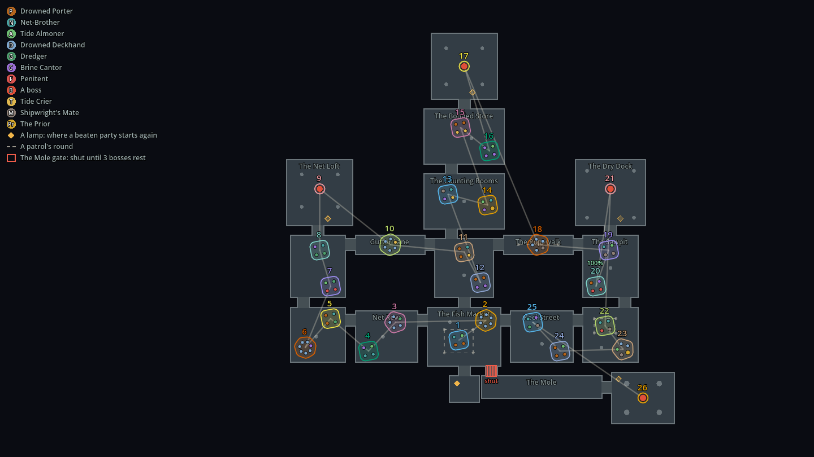

# Fourfold — design

Status: **approved and built.** The game is the Godot project in [`game/`](game/README.md), published from `main`. Numbers below are its tuned values.

**Next:** route planning, a second and larger dungeon, and gear were agreed on 15 November 2026. The first two steps are built: the dungeon is rooms joined by doorways, enemies are worth count, a beaten party starts again from a sanctuary lamp, and you can plan a route on a map which the AI then follows. The rest is not built yet. Section 12 sums it up; the full record is [`docs/routing-and-gear-plan.md`](docs/routing-and-gear-plan.md).

Fourfold was first built in TypeScript as a side-on belt-scroller (kept at the tag `typescript-game`), and this document was written for that game. It was then rebuilt in Godot with an isometric view, which is the game now. The rules here hold for it, and section 3 (controls) describes it. Some passages, section 11 above all, still describe how the first version looked and sounded; where the game differs from them:

- The dungeon, heroes, enemies, AI, clock, unlocks and bests are all in and run to the same times as before (all-AI: about 7:25 to 8:05 at level 1, 10:15 to 11:00 at level 5, 12:00 to 13:00 at level 7).
- Effects over time always get their last tick. In the TypeScript game rounding dropped it for some, so Mending Kelp healed 360 and Tallow Burn dealt 200; here they give the 420 and 240 their descriptions promise.
- The interface is rebuilt to section 8, in plain grey-box styling: the title, the party setup (with the key editor and the level), the run's frames and action bar, the pause menu and the summary. Party setup and level select share one screen.
- The story is spoken as well as shown: the opening card is read by a narrator, the party's lines are said aloud in their own voices with a speech bubble, and the summary ends on one of the two endings. The voices are made with Kokoro (text to speech); there is a volume slider and an "Off" box on the setup screen and in the pause menu.
- The art is a starter set of stand-ins, to be replaced figure by figure: chunky low-poly humanoids with arms and legs (the storybook bell-shaped figures of section 11 would not take a skeleton), the drowned as sea-green skeletons, and the Abbey laid from a free dungeon kit under teal fill light and a warm key light. [`game/assets/README.md`](game/assets/README.md) lists what stands in for whom and how to swap each.
- Sound effects and music are files now, not synthesised as the game runs: the music of section 11 (the drone, the bells, the drum, the choir, the tide bell) is rendered to loops by a script, three moods for each part of the abbey, and the game fades between them. The effects are a mix of free recordings and bells from the same script. An enemy's chant is one swelling voice, pitched by who sings, that stops when the cast lands or is cut off.
- Not rebuilt yet: weather, the zones' own looks, the rising tide and the sea growing louder in the last two minutes.

Fourfold is an original, solo, browser-based dungeon runner in the style of timed five-player MMO dungeons. You play one hero in a party of four; AI plays the other three.

## 1. Settled decisions

| Area | Decision |
|---|---|
| Control | You play one hero per run. AI plays the other three. |
| Party | 1 tank, 1 healer, 2 DPS. You choose every slot, duplicates allowed. |
| View | Real-time isometric: a 3D floor seen from a fixed camera looking down from one corner, which follows your hero. (The first version was a belt-scroller seen from the side.) |
| Run | Two dungeons, each with an enemy count to meet and a timer, run by a route you may plan on a map. The Drowned Abbey is short and linear: 6 trash packs, 3 bosses, 14 minutes. Tollhaven is large, with a choice of ways through: 22 trash packs, 4 bosses, 25 minutes (section 7b). |
| Levels | Enemies gain 8% health and damage per level (compounding), plus new abilities at levels 3, 6 and 9. No cap. |
| Unlocks | You may start any level up to one above your highest timed clear in that dungeon. Each dungeon keeps its own levels; they are shared across heroes. |
| Progression | No gear yet. Highest timed level and best time are recorded per hero, for each dungeon. Planned: gear, teams and a shop (section 12). No talents; gear abilities do that job. |
| Visuals | 3D figures and room pieces as files in `game/assets`, one colour and one hat per character. A starter set of stand-ins for now. |
| Sound | Voice, effects and music as files in `game/assets`. See section 11 for the music. |
| Story | The Last Vespers: a light story told through one opening card, speech bubbles and an ending. See section 11. |
| Tech | Godot 4 (GDScript, Compatibility renderer), exported for the web. No backend; the save is in the browser's storage. GitHub Pages. Desktop keyboard and mouse only. |

## 2. Run flow

1. **Title** → **Party setup**: pick your hero, then the heroes for the three AI slots.
2. **Dungeon and level**: either dungeon, at any level unlocked in it. **Plan the route** if you wish; without a plan the party goes the safe way.
3. **Run**: the timer starts on the first pull and stops when every boss is dead and the count is met.
4. **Summary**: time, result, and per-hero damage, healing, interrupts, dispels and deaths.

Result rules:

- **Timed**: every boss dead and the count met inside the dungeon's time limit (14:00 in the Abbey, 25:00 in Tollhaven). Unlocks that dungeon's next level.
- **Completed**: the same, over the limit. Recorded, unlocks nothing.
- There is no way to fail outright; you can abandon from the pause menu.

### Routes

- A route is an ordered list of **pulls**. A pull is one or more packs taken together, in the order they were added. It may also say where the tank holds them, where the healer and each damage dealer stand, that the tank should **go at once** without waiting for the party, and carry a one-line note. Anything left out is the AI's choice.
- Every dungeon comes with a route called **the safe way**: each pack by itself, in order. It is what the party follows if you never open the map, and what the map shows first, ready to change.
- Routes are kept for each dungeon in **three slots** with names; a run follows the one used last. A route can be copied out as a line of text (it begins `FF1:`) and loaded from one.
- If the plan leaves something out, the run can still start: once the plan runs out the party takes the nearest pack that still stands, or the nearest boss once the count is met.
- If the plan breaks (the party is beaten, or wakes a pack it did not mean to), the party finishes that fight and then makes the first pull that still has a pack standing. Packs already dead are passed over.
- A pull whose packs are behind a gate that is still shut is passed over too, and made once the gate opens.

## 3. Controls

| Input | Action |
|---|---|
| W A S D | Move as the screen shows it: W up the screen, S down it, A left, D right. Two keys together move on the diagonal at the same speed. Your hero faces its target, or the move direction if it has none. |
| Q E | Also left and right. |
| Space | Jump. For show only: it clears nothing and changes nothing in a fight. |
| Mouse wheel | Zoom in and out between two limits. Two-finger scroll or pinch does the same on a trackpad. |
| Tab | Target the next enemy in line of sight, nearest first. |
| Left click | Target the enemy whose figure is under the mouse; a near miss still counts. |
| 1–6 | Use ability. T is also the interrupt and ` is also the personal defensive (the fifth ability). All of these can be changed. |
| Middle and side mouse buttons | Use the ability bound to them, wherever the pointer is. Unbound by default. |
| Esc | Clear target; again to open the pause menu. |
| P | Pause. |
| M | Open the map, between fights; M or Esc closes it. The run stands still while it is open. |

- **Movement** is relative to the camera, not the dungeon: the halls run from the lower left of the screen to the upper right, so W and D together walk straight along them. The hero reaches full speed (8.5 m/s) in about a tenth of a second and stops as quickly.
- **The camera** never turns. It trails the hero slightly and leads about a metre in the direction of travel.
- **Enemy abilities** go to your enemy target. With no target, they go to the tank's target.
- **Ally abilities** go to the ally under the mouse (hero on the map or party frame). With no ally under the mouse, they go to yourself.
- **Auto-attacks** fire on your enemy target whenever it is in range and in line of sight.

### Keys and mouse buttons

- Every ability has two key slots and one mouse-button slot (middle, side back, side forward). The editor is on the party setup screen and in the pause menu, and bindings are saved per hero.
- A key or button does one thing: binding it to an ability takes it away from the ability that had it.
- Movement, Space, Tab, Esc, P and M are kept for the game and cannot be bound.
- An ally ability cast from a key or mouse button lands on the ally under the pointer, as usual.

### Click-to-cast (healers)

- Clicking a party frame casts the spell bound to that click. It applies to party frames only; clicking a hero on the map does nothing.
- Defaults: left click is Mend / Mending Vine, right click is Quick Mend / Bark Ward, Shift + left click is the dispel, Shift + right click is the damage reduction.
- Any ally spell can be rebound to left, right, middle or side click, plain or with Shift, Ctrl or Alt. On a party frame, a click-cast for a button comes before a mouse-button binding for it. Your own frame, above the party row, takes click-casts too. The editor is on the party setup screen and in the pause menu, and bindings are saved per healer.
- Keys 1–6 keep working alongside it.

## 4. Combat rules

### Global rules

- **Global cooldown**: 1.5 s, shared by all abilities not marked "off GCD". The Duelist's is 1.0 s.
- **Casting**: moving cancels a cast. Instant abilities can be used while moving.
- **Range**: melee is 3 m. Ranged abilities and heals are 30 m.
- **Speed**: heroes move 8.5 m a second, enemies 6.5.
- **Interrupts** stop the cast and lock the enemy out of that ability for 3 s. Only casts with a yellow bar can be interrupted; grey bars cannot.
- **Dispels** remove every debuff marked dispellable from one ally.

### Line of sight

- Walls and pillars block movement and line of sight.
- Every ranged attack, cast and heal needs a clear line from caster to target when it starts and when it finishes. A cast that loses its line fails and its cost is refunded.
- This applies to enemies too. An enemy caster or archer with no line to its target walks until it has one, so a tank can gather ranged enemies by pulling them and stepping behind a corner.
- Ground effects and melee attacks ignore line of sight.
- You can see the whole room; line of sight limits actions, not vision.
- Ranges and line of sight are measured on the floor. There are no lanes: an enemy deeper in the room is hit like any other.
- A pillar turns see-through while someone stands behind it.

### Threat

- Each enemy keeps a threat table and attacks whoever is highest.
- Damage generates 1 threat per point. The Warden's damage generates 4 per point.
- Healing generates 0.5 threat per point healed, split across every enemy in combat.
- An enemy switches targets when another hero passes 110% of its current target's threat (130% for heroes outside melee range).
- The Warden's Challenge puts the Warden on top and forces the target for 4 s. It shows on the enemy as a 4 s debuff.

### Death and recovery

- A dead hero stays down until combat ends, then revives. Each death adds 5 s to the timer.
- If all four die, every pack in the fight resets to full health, destroyed pillars are rebuilt, and the party revives at the sanctuary lamp it lit last. The landing counts as the first; after that each boss's lamp, which stands by the way on from its room.
- Out of combat, health and resources refill at 10% per second.

### Count

- Each enemy is worth points towards the dungeon's **count**. Bosses, and anything a boss calls up, are worth nothing.
- Count is earned as each enemy dies. If the party is then beaten, the pack stands up again and its count is taken back.
- A run is complete when every boss is dead and the count is met. The Abbey asks for all the count it holds, 92, because nobody can walk past a pack in it. Tollhaven holds 300 and asks for 231, so about a quarter of it can be left standing, and which is the route's choice.

### Waking, patrols and gates

- A sleeping pack wakes when a hero comes within 11 m of one of its enemies and in its sight, or when one of them is hit, hailed or silenced. The whole pack wakes together. Packs do not wake each other.
- A **patrol** is a pack that walks a set round, at 2.6 m a second, until it is woken. It wakes like any other pack, so it can walk into a fight or into a party that is waiting. Beaten back, it takes up its round where it left it.
- A **gate** is a doorway that is shut until certain bosses are at rest. Nothing passes it and nothing sees through it. It opens the moment the last of them falls.

## 5. Heroes

All six have six abilities: three rotational, one interrupt or dispel, one defensive, one major cooldown.

### Warden — tank

2400 health. **Rage** (0–100): +2 per auto-attack, +1 when hit (at most once a second), drains out of combat. Gains are kept low so Brace has to be timed, not held up permanently.

| Key | Ability | Cost / cooldown | Effect |
|---|---|---|---|
| 1 | Shield Strike | 4.5 s cd | 110 damage. +8 rage. |
| 2 | Sweep | — | 50 damage to every enemy within 6 m. +1 rage per enemy hit, up to 5. |
| 3 | Challenge | 8 s cd, off GCD, 30 m | Target attacks you for 4 s and you go to the top of its threat. The ranged pull. |
| 4 | Shield Bash | 15 s cd, off GCD, melee | Interrupt. |
| 5 | Brace | 40 rage, off GCD | Take 50% less physical damage for 6 s. |
| 6 | Unbreakable | 2 min cd, off GCD | Take 40% less damage of all kinds for 10 s and heal 20% of maximum health. |

### Mender — direct healer

1200 health. **Mana** (1000): +8 per second in combat. Weak ranged auto-attack.

| Key | Ability | Cost / cooldown | Effect |
|---|---|---|---|
| 1 | Mend | 40 mana, 2.0 s cast | Heal 420. Also heals the most injured other ally within 10 m of the target for 30%. |
| 2 | Quick Mend | 90 mana, instant | Heal 330. |
| 3 | Rebuke | 1.5 s cast | 70 damage. Restores 15 mana. |
| 4 | Purify | 30 mana, 8 s cd | Dispel one ally. |
| 5 | Guardian Ward | 45 s cd, off GCD | An ally takes 40% less damage for 6 s. |
| 6 | Sanctuary | 2 min cd | Heal every ally for 300 now and 600 more over 8 s. |

### Bloomweaver — heal-over-time and shield healer

1200 health. **Mana** (1000): +12 per second in combat, since there is no damage spell to win mana back with. Weak ranged auto-attack.

| Key | Ability | Cost / cooldown | Effect |
|---|---|---|---|
| 1 | Mending Vine | 30 mana, instant | Heal 60 every 2 s for 14 s. One per ally; recasting refreshes it. |
| 2 | Bark Ward | 42 mana, 3 s cd | Shield an ally against the next 350 damage, for 12 s. |
| 3 | Bloom | 45 mana, 10 s cd | Every ally with Mending Vine is healed for 240 at once. The vines keep running. |
| 4 | Cleansing Dew | 30 mana, 8 s cd | Dispel one ally. |
| 5 | Bramble Guard | 45 s cd, off GCD | An ally takes 30% less damage for 8 s. |
| 6 | Verdant Tide | 2 min cd | Put Mending Vine on every ally. For 10 s vines tick twice as fast and Bark Ward has no cooldown. |

### Duelist — melee DPS

1300 health. **Energy** (100): +20 per second. **Combo points** (0–5). Global cooldown 1.0 s. Energy comes back fast and hits are small, so there is a button to press about every two seconds, and every second during Bloodrush.

| Key | Ability | Cost / cooldown | Effect |
|---|---|---|---|
| 1 | Slash | 40 energy | 60 damage. +1 combo point. |
| 2 | Whirl | 45 energy | 35 damage to every enemy within 5 m. +1 combo point. |
| 3 | Finishing Thrust | 25 energy, all combo points | 45 damage per combo point. |
| 4 | Hilt Jab | 15 s cd, off GCD, melee | Interrupt. |
| 5 | Riposte | 60 s cd, off GCD | Take 50% less damage for 5 s. |
| 6 | Bloodrush | 2 min cd, off GCD | For 12 s, energy regenerates twice as fast and you deal 20% more damage. |

### Ranger — ranged physical DPS

1200 health. **Focus** (100): +4 per second. Every ability can be used while moving. Strong ranged auto-attack.

| Key | Ability | Cost / cooldown | Effect |
|---|---|---|---|
| 1 | Quick Shot | — | 60 damage. +15 focus. |
| 2 | Piercing Shot | 45 focus | 190 damage. |
| 3 | Scatter Volley | 40 focus | 75 damage to the target and every enemy within 6 m of it. |
| 4 | Jarring Shot | 20 s cd, off GCD | Interrupt at range. |
| 5 | Tumble | 20 s cd, off GCD | Roll 8 m in your move direction and take 30% less damage for 3 s. |
| 6 | Hawk's Focus | 90 s cd, off GCD | For 10 s, auto-attacks fire 50% faster and Quick Shot gives double focus. |

### Pyromancer — caster DPS

1100 health. **Heat** (0–100), built by casting and spent on Flame Burst. Weak ranged auto-attack.

| Key | Ability | Cost / cooldown | Effect |
|---|---|---|---|
| 1 | Firebolt | 2.0 s cast | 170 damage. +25 Heat. |
| 2 | Ignite | instant | 240 damage over 12 s. +10 Heat. One per enemy. |
| 3 | Flame Burst | 50 Heat, instant | 200 damage to the target and 90 to every enemy within 6 m of it. |
| 4 | Stifle | 20 s cd, off GCD | Interrupt at range. |
| 5 | Ember Shield | 45 s cd, off GCD | Shield yourself against the next 400 damage, for 8 s. |
| 6 | Kindled Mind | 2 min cd, off GCD | For 12 s, Firebolt casts in half the time (1 s, with a 1 s global cooldown). |

## 6. AI teammates

Teammates play reliably well at every level, with reaction delays of 0.3–0.6 s. They do their own job fully and never do yours.

- **All roles**: step out of ground effects and frontals and never walk into one, stay in range and line of sight, use their defensive below 40% health. They keep 14 m away from packs that are not in the fight.
- **Going in**: every fight happens inside the room. The tank pulls from the doorway and then walks to a spot about 8 m inside (10 m for a boss). Everyone else stays in whatever room the tank is in, at least 1.5 m clear of its doorways, so nobody hangs back on a threshold. While the tank stands in a doorway, either room it joins will do. The story reason: the sea comes in over each doorway once the party is through it.
- **AI tank**
  - Pulls the next pack when everyone is alive, above 80% health, and the healer is above 60% mana.
  - Stands among the ranged enemies so the melee ones are dragged onto them, and faces enemies away from the party.
  - Holds Brace for tank busters and uses Unbreakable below 35% health.
- **AI healer**
  - Heals the most endangered ally first and keeps the tank topped up.
  - Dispels within about a second.
  - Uses the damage-reduction ability on tank busters and the major cooldown when three allies are below half health.
- **AI DPS**
  - Wait 1.5 s after the tank's first hit on the pack woken last before attacking, then focus the tank's target.
  - Switch to priority targets (enemy healers first).
  - Use the major cooldown on bosses and large packs.
- **When you tank**: nobody attacks until you do. AI DPS then go all out; holding threat is your job.
- **Held fast** (netted): a hero does nothing until freed. The damage dealers turn on a net at once, and of two nets cut the healer's first. If no damage dealer is free to, the tank cuts one, and whatever it was fighting follows it there.
- **Told to shelter** (Lights Out): everyone goes to the nearest lit circle and fights from there until it is over.
- **Carrying a circle** (Seize): the marked hero walks to the nearest spot that leaves everyone else outside it.
- **A turning beam**: the ground it is about to sweep counts as part of it, so a hero ahead of it moves on before it arrives.
- **A burning patch**: nobody stops in one. The tank, chased off one, steps to the nearest clear spot that is nearest where the pull is held, so that it goes round that spot and not ever further from it, and then holds where it stands. Everyone else walks round a patch to get where they are going, and crosses one only if there is no way round.

### Following a route

- **Gathering.** For a pull of several packs the tank wakes them in the order they were added: with its hail (Challenge) when that is ready and the pack is in sight within 27 m, otherwise by walking at it. It then takes them all to where it holds the pull.
- **Holding.** With a tank spot planned, the tank goes to it and stays on it, stepping off only to get out of danger. It does not move among the ranged enemies as it otherwise would: where they end up is part of the plan. With none planned it goes in as usual, in the room of the pack woken last.
- **Holding damage.** While an AI tank is still gathering, nobody else attacks, for up to 15 s. With you as the tank they go when you do, as always.
- **Spots.** A ranged hero or the healer with a planned spot walks to it before the pull, if it can be stood on without waking anything, and the tank waits for them to be there. In the fight they stay on it for as long as it does its job: within 28 m and in sight of whoever they are there for, and not in front of an enemy that cleaves. Otherwise they pick a spot of their own. A melee hero uses its spot only as the side to attack from. Everyone still leaves a spot to dodge, and returns.
- **No spot.** A hero with nothing planned keeps with the tank while it gathers, then fights as usual.
- **Waiting.** The tank waits for the party before each pull as before, unless the pull says go at once.
- **After a wipe** the tank goes in again as it did the first time.
- **Walking round packs.** A pack that sleeps and is not in the pull being made or fought is kept clear of: its ground is everything within 15.7 m of its middle (4.2 m further than it can notice) that it could see, which is its own room, that room's doorways and whatever shows through them. Whenever the plain way to where an AI hero is going would cross such ground, the hero takes a way round instead, however long. Only if there is no way at all does it go through, by the way that wakes fewest. This holds between pulls and in a fight, for the tank and for everyone else. A patrol's ground moves with it.
- **Never onto watched ground.** A spot that is itself on such ground is not walked onto: the hero stops short of it. A melee hero whose place behind its target would be within 12.5 m of a sleeping enemy takes the nearest side of the target that is not, or holds off.
- **Patrols.** The tank goes to wherever a patrol has got to, hails it when it is in sight within 27 m, and holds it at a spot the level gives for that patrol.
- **When you tank** the route cannot steer you. It is shown instead: the next pull's number over its packs and a ring where the plan would have you hold. The AI healer and damage dealers still use their planned spots.

### Interrupt turns

- Each interruptible cast is assigned to one party member: whoever has an interrupt ready and has gone longest without using it.
- When the turn is yours, the enemy cast bar is marked **KICK**. AI teammates do not cover a turn that is yours.
- If your interrupt is on cooldown, the turn goes to someone else.

## 7. The dungeon — The Drowned Abbey

Sections 4 to 7 describe mechanics under their original working names. The names players see are listed in section 11.

Linear: two packs, a boss, two packs, a boss, two packs, a boss.

- **Layout**: ten rooms in a row, each joined to the next by one doorway: the landing where the party starts, then a room for each pack and boss. Pack rooms are 28 m long and 16 m deep; boss rooms are 34 m long and 20 m deep. The rules know the dungeon only as rooms and the doorways joining them, not as a row.
- **Dividing walls**: each room is split from the next by a 3 m wall that juts out from the back and leaves a 6 m doorway along the front edge. The AI tank pulls from the doorway and then goes in. A player tank can still step back behind the wall for a line-of-sight pull; the AI party follows it.
- **Pillars**: several rooms have pillars that block movement and sight.
- **View**: depth is drawn at 60% scale. The front edge of the floor is open; nothing stands between the camera and the party except pillars.

### Enemy types

| Enemy | Count | Behaviour | Added at level 3 |
|---|---|---|---|
| Brute | 4 | Melee. Hits its target hard and often. | Crushing Blow: a telegraphed tank buster. |
| Hexer | 3 | Caster. Dark Bolt (interruptible) at a random hero. | Wither: interruptible; if it lands, a dispellable damage-over-time debuff. |
| Archer | 3 | Ranged attacks on its target. | Arrow Rain: a ground circle under a random hero. |
| Shaman | 3 | Caster. Restore (interruptible) heals an injured enemy. Priority target. | Restore heals more. |
| Berserker | 4 | Fast melee. Enrages below 30% health. | Enrage starts at 50%. |
| Overseer | 8 | Elite melee. Sweeping Cut: a telegraphed frontal cone. | Rally: nearby enemies deal 15% more damage while it lives. |

At **level 9**, every trash enemy deals 25% more damage below 25% health.

### Packs

| Pack | Enemies | Count | Teaches |
|---|---|---|---|
| 1 | 3 Brutes, 1 Hexer | 15 | Threat, first interrupts. |
| 2 | 2 Brutes, 1 Archer, 1 Shaman | 14 | Priority targets. |
| 3 | 2 Brutes, 2 Hexers (pillared room) | 14 | Casters and line of sight. |
| 4 | 1 Overseer, 2 Archers, 1 Shaman | 17 | Frontals. |
| 5 | 2 Berserkers, 1 Hexer, 1 Shaman | 14 | Enrage damage, cooldown use. |
| 6 | 1 Overseer, 1 Berserker, 2 Archers | 18 | Everything together. |

### Boss 1 — Krogg the Gatebreaker (tank check)

- **Skullcrack**: telegraphed heavy physical hit on the tank. Answer with Brace or a healer's damage reduction.
- **Rending Sweep**: wide frontal cone. The tank faces Krogg away; everyone else stays behind him.
- **Frenzy**: below 30% health Krogg attacks 30% faster.
- **Level 6 adds** Tremor: ground circles under two random heroes.

### Boss 2 — Matron Velisse (adds and interrupts)

- **Brood**: every 25 s, three Hatchlings spawn. The tank must pick them up; DPS must kill them.
- **Venom Bolt**: Hatchlings cast it constantly (interruptible, weak alone, dangerous together).
- **Brood Mending**: Velisse heals herself for 10% (interruptible, must be stopped).
- **Level 6 adds** Bursting: a Hatchling leaves a ground circle where it dies.

### Boss 3 — Archon Sulmar (party damage, dodging, dispels)

- **Dirge**: unavoidable damage to everyone for 5 s, every 20 s. Healed through.
- **Ashfall**: a ground circle under every hero. Move out.
- **Searing Brand**: a dispellable damage-over-time debuff on two heroes.
- **Annihilation**: at 66% and 33% health, a 5 s cast that nearly kills anyone in line of sight. Hide behind a pillar.
- **Level 6 adds**: Annihilation destroys the pillar that was used.

## 7b. The second dungeon — Tollhaven

The harbour town under the Abbey. It was proposed in [`docs/tollhaven-proposal.md`](docs/tollhaven-proposal.md) and approved as proposed. Names here are the ones players see.

The numbers are the pulls of the safe way, the dotted lines the patrols' rounds, and the diamonds the lamps.

- **Layout**: eighteen rooms. The party starts on the Sea Stair, which opens into the **Fish Market**. Three wings lead off the market, each three rooms and then a boss: west (Net Row, the Drying Yard, the Smokehouse, the Net Loft), north (Chandlers' Cross, the Counting Rooms, the Bonded Store, the Custom House) and east (Keel Street, the Timber Yard, the Sawpit, the Dry Dock). Two passages join the wings near their far ends: **Gutter Lane** from the Smokehouse to Chandlers' Cross, and the **Ropewalk** from Chandlers' Cross to the Sawpit. A pier, the **Mole**, runs from the market to the **Harbour Light**, where the last boss is; its gate is shut until the other three bosses are at rest.
- **Rooms** are 30 m or more across and joined by 6 m doorways. North and east walls are tall; south and west walls, which the camera looks over, are 1.45 m: low enough to hide little, high enough to block sight.
- **Packs**: 22 of keepers, two to a room in the market and the nine wing rooms and one in each passage. In most rooms one pack stands where it guards the way through, and the other in a far corner where it can be walked past. Three are patrols: the Harbour Watch round the market, the Rope Gang up and down the Ropewalk, and the Yard Watch round the Timber Yard.
- **Count**: it holds 300 and asks for 231. By the safe way's order, the eight packs that cannot be left are Net Row, the Drying Racks, the Smoke Racks, Gutter Lane, the Cross Well, the Counting Desks, the Bonded Casks and the Saw Benches. Two more can be left only at the cost of a long walk at the end, because they stand over the doors back into the market: Keel Street (261 m round) and the Fish Stalls (420 m). Taken in another order, or by the passages, the choice changes: Net Row and the Drying Yard can be left out altogether by going to Mother Hask through Gutter Lane.
- **Lamps**: one on the Sea Stair, and one by the door of each boss's room, lit when that boss falls.
- **The safe way** takes every pack: the market, the west wing and Mother Hask, Gutter Lane, the Cross and the north wing and Exciseman Corrow, the Ropewalk, the Sawpit and Old Garrow, back through the Timber Yard and Keel Street, then the Mole and the Keeper.
- **Time**: 25:00.

### New enemies

| Enemy | Role | What it does |
|---|---|---|
| Drowned Deckhand | Swarm | Weak (750 health), six to a pack, worth 1 count. |
| Tide Crier | Caster, priority target | **Cry the Hour**: a 3 s cast, silenceable, that wakes the nearest sleeping pack of keepers within 35 m. Never a boss. |
| Shipwright's Mate | Melee | **Tarred Shield**: 60% less damage from heroes in front of it (within 77° of the way it faces). Threat is counted as if the blow had landed whole. Level 3+: Caulking Maul, a tank buster. |
| Dredger | Melee | **Grapple**: a 1.5 s cast that hooks the hero furthest off (beyond 8 m, and in its sight) and drags them to its feet, with a blow. |

Count: 1 for a Deckhand, 4 for a Tide Crier, 5 for a Shipwright's Mate and a Dredger.

### Bosses

- **Mother Hask, the Netwife** (the Net Loft; a check on switching targets). 24,000 health.
  - **Cast Net**, every 20 s: nets a hero, never the one she is fighting. A netted hero cannot move or act, and is squeezed for 20 a second, until the net is cut down. The net is a target with 1,000 health. From level 6 she nets two at once, in nets each half as stout.
  - **Haul**, 10 s after a net lands: a 2.5 s cast, then everyone still netted is dragged to her feet, net and all, and she strikes everyone within 7 m for 280.
  - Level 3+: Gutting Knife, a tank buster.
- **Exciseman Corrow** (the Custom House; a check on silences). 25,000 health.
  - **The Audit**, every 30 s: three 2.2 s casts one after another, each to be silenced, so the party must take turns. One that lands puts the Tax on a random hero: 48 damage a second and a fifth less damage done for 14 s, cleansable. From level 6 it is four casts.
  - **Seize**, every 22 s: marks a hero, never the one he is fighting, with a 7 m circle that goes off in 5 s wherever they are, for 430 to everyone in it.
  - **Stamp and Seal**: a tank buster for 640.
- **Old Garrow, the Shipwright** (the Dry Dock; a check on where everyone stands). 27,000 health.
  - **Launch**, every 24 s: a hull runs down one of three slips, a lane 7 m wide the length of the dock, after 3 s of warning, for 620. From level 6 a second hull crosses the first.
  - **Pitch Pot**, every 9 s: a 4 m circle at the tank's feet that lands after 1.6 s for 170 and then burns for 26 s, 75 a second to whoever stands in it. The tank must keep moving him.
  - **The Adze**: a tank buster for 600.
- **The Keeper of the Light** (the Harbour Light; the last check: moving, healing and hiding together). 31,000 health.
  - **The Beam**, every 28 s: a cone of light 28 m long that starts pointing away from the tank, and after 2 s of warning turns round him for 11 s at 0.38 radians a second (0.55 from level 6), burning whoever it falls on, and he can see, for 115 every half second. Keep ahead of it, or behind one of the four pillars.
  - **Lights Out**, at 60% and 30% health: a 5 s cast. Three lit circles appear; whoever is not in one when it ends takes 90% of their health. The Beam goes out with the rest.
  - **Undertow**: 55 a second to everyone for 5 s, every 22 s.

### What the game learned for it

- A level may have **gates**, **patrols** and its own **time limit**.
- Telegraphed zones may be a **lane**, may **stay** and go on burning after they land, may **move with a unit**, may **turn**, and may be a place to **shelter** in.
- An aura may **hold** a unit fast. An enemy may be a thing that only stands there (a net), may **guard its front**, and may pick the hero **furthest off**.
- The cast wear the Abbey's figures, washed with a colour of their own, until they have figures made for them.

## 8. Interface

- **Bottom of the screen**, from the bottom up: the action bar; the party frames in one row; then your own frame on the left and the target frame on the right, with your cast bar between them.
- **Party frames**: health, resource, shields, heal-over-time, dispellable debuffs (highlighted), active defensives.
- **Your frame**: name, health and resource with numbers, combo points for the Duelist.
- **Target frame**: health, cast bar, who the enemy is attacking (red when it is not the tank), and everything on it with the seconds left. Your own debuffs come first, edged in gold.
- **Figures**: heroes wear their role colour with a ring under their feet; yours has a yellow ring and a marker overhead. Your target has a red ring.
- **Nameplates** over every enemy: health, cast bar (yellow = interruptible, grey = not, **KICK** = your turn), and a border that turns red when the enemy is attacking a non-tank.
- **Debuff chips** under each nameplate: one per debuff the party has put on the enemy, in its caster's colour, draining as it runs out and showing the seconds left (tenths in the last three). Yours come first, edged in gold.
- **Action bar**: six buttons with their keys and mouse button, cooldown sweep, cost and out-of-range or no-line-of-sight dimming. Hover for a tooltip.
- **Run bar**: timer against the dungeon's limit, then the count as a bar and a percentage of what the dungeon asks for, lamps lit, deaths, and the number of the pull being fought or coming next.
- **The plan on the ground**: the next pull's number floats over each of its packs that still sleeps, a ring in the tank's colour marks where the plan has the tank hold, and a gold ring marks your own spot. A box on the setup screen and in the pause menu turns these off.
- **The map** (before a run from "Plan the route", during one with M): the dungeon from straight above, drawn from the level's own description, all of it visible. It is laid out like Mythic Dungeon Tools and Keystone.guru. The map is on the left; on the right the list of pulls with the count above it.
  - Each pull has a colour and a number. On the map one outline in that colour is drawn round all the packs of the pull, so packs taken together read as one shape, and a line joins the pulls in order; packs in no pull are grey. In the list a row shows the pull's enemies as lettered discs with how many, what it is worth and the count reached by the end of it. The pull that reaches 100% is marked in green.
  - Click a pack to put it in the pull being edited, again to take it out. Shift-click, or "Add a pull", starts a new pull. Click a row to edit that pull, drag it to change the order, right-click it to insert a pull above, join it to the one above, or delete it.
  - Four markers are dragged onto the map to set the spots of the pull being edited: a shield for the tank, a cross for the healer and a sword for each damage dealer, in their heroes' colours. Dropped off the floor, or right-clicked, they go back.
  - Resting the pointer on a pack, or on a row of the list, lists its enemies with their health at the chosen level and their count, and says what each of them does and from which level.
  - The wheel zooms about the pointer; dragging moves the map.
  - It warns when the route falls short of the count or never pulls a boss, when a pull cannot be reached without waking a pack that is not in it ("Pull 3 cannot be reached without waking Net Row"), and when a pull is behind a gate that will still be shut. It also says when a pull is reached cleanly but only by a long way round ("Pull 25 is reached the long way round, 261 m, to keep clear of Keel Street"), which is what the AI will walk. It still lets the run start. All of this is worked out by walking the route in order from the start, taking each pull's packs as dead once it is made; patrols are left out of it, since where one is when the party passes is for the party to watch.
  - A patrol's round is drawn as a dotted line, and a shut gate as red bars across its doorway. The key says what each gate waits for.
  - Over a run, packs already dead are shown as done and cannot be moved, the party's positions are shown, and changes take effect at once.
- **Telegraphs**: ground circles and cones drawn on the floor before they hit.
- **Camera**: follows your hero, runs 1 m ahead of the way you are walking, and leans up to 7 m towards the fight, so both stay on screen. AI teammates fight within 21 m of their target for the same reason. A heavy hit on a hero jolts the screen, more so when it is on you; this is off when the system asks for reduced motion.
- **Alerts**: a short text call for major boss casts.
- **Party setup** shows each hero's abilities and a short "how to play".

## 9. Technical

- **Rules** run on a fixed step of 60 ticks a second as plain GDScript classes with no scene in them (`game/rules/`), so they can be tested on their own. The nodes ask them what is allowed and show what they report.
- **A level** is one description in code (`game/rules/level_def.gd`): rooms and the doorways joining them, walls, pillars, packs and the rounds of those that patrol, gates, sanctuary lamps, the count it asks for and its time limit. The scene builds the floor, collision and navigation from it; the rules ask it which room a spot is in; the tests read the same thing.
- **Finding a way round packs** is the rules' own (`game/rules/paths.gd`): the floor cut into 1.5 m squares, with a square on ground a sleeping pack watches costing forty times any other. The AI and the map's warnings both ask it.
- **Movement** belongs to the engine: units are physics bodies, walls block them, line of sight is a ray cast and the AI walks a navigation mesh. Physics interpolation keeps motion even on any refresh rate.
- **Automated runs**: the same scene runs headless with AI in all four slots. The tests check that every party composition times level 1; `tests/tools/sim.gd` prints times, deaths and per-hero output for the given levels and number of seeds (see [`game/README.md`](game/README.md)).
- **Balance as tuned**: all-AI parties time level 1 in about 8 minutes and level 7 in 12–13. Most still time level 8; they start wiping on the last boss around level 9–10.
- **What a route is worth in the Abbey**, measured with all-AI parties at level 5 (the safe way: 10:11 to 11:04): pulling the packs of each part in pairs with nothing else planned changes nothing (10:19 to 11:05), because the ranged enemies stay spread out and gathering takes time. Marking every pull "go at once" changes nothing either, since the party is ready by the time the tank arrives. Pairs held behind the wall between their two rooms, so that the second pack has to come through the doorway to the tank, save 20 to 30 seconds (9:50 to 10:33), and one party in six wiped once doing it.
- **Under the bonnet**: F9 lets the AI play your hero too, F8 swaps the dungeon for a sandbox hall, F3 shows speed and frames a second. Adding `?debug` to the URL exposes the hero's state as `window.fourfold` for browser tests.
- **Save data**: the browser's storage only: crew, the dungeon chosen, and for each dungeon the level chosen, the level unlocked and per-hero bests; key bindings, volume, and three routes for each dungeon. It is plain data with a version number (now 3). A save from before Tollhaven is read as the Abbey's.
- **Deploy**: a GitHub Action tests, exports and publishes to GitHub Pages on every push to `main`.

## 10. Out of scope for the first version

Gear, talents, run modifiers, route choices, more dungeons, mobile and touch, rebinding the movement keys, saving mid-run.

Of these, routes are now built, and a second dungeon and gear are planned (section 12). Talents are dropped for good: gear abilities do that job.

## 11. Theme: The Drowned Abbey

The theme is a reskin. Ids, numbers and mechanics are unchanged; only names, drawing, sound and words differ.

### Settled decisions

| Area | Decision |
|---|---|
| World | A monastery drowned under a tidal sea. |
| Tone | Melancholy but warm: a small party doing a hard, kind job. |
| Premise | The Last Vespers. A century ago Abbot Sulmar rang the great bell against a storm and the sea took the abbey. Once a season the tide draws back for fourteen minutes. A crew of four, a Fourfold, goes down to relight three sanctuary lamps. |
| Timer | The 14:00 timer is the tide. The sea at the front edge of the hall rises as it runs, and covers the floor once time is up. |
| Enemies | The monks who stayed. They are not evil; they are still at their posts. When one falls it rises into light and bubbles: laid to rest, not killed. |
| Palette | Tidelight: sea-teal glow, candle gold, coral for danger, bone for text. The interface's colours are in `game/ui/kit.gd`. |
| Figures | Storybook: bell-shaped body, big round head, soft shading, one hat and one prop each. (The first version; the stand-in figures are chunkier and have legs.) |
| Level space | Three zones of three encounters, each ending in a lamp. |
| Interface | Wet slate: dark see-through panels with gold edges and old-print lettering. Parchment only for the story card and speech bubbles. |
| Story weight | One opening card, one line of banter per pull and boss, a line per lamp, two endings. No cutscenes. `game/rules/story.gd`. |
| Sound | First synthesised as the game ran; now files made to the same recipe by `tools/audio/make_audio.py`. On by default, with a volume slider and an "Off" box on the setup screen and in the pause menu. |
| Weather | (Not in the game yet.) Drawn from the clock: rain that leans with the gusts at the Sea Gate, drips from the Infirmary vault, dust and candle smoke in the Nave. |
| Thresholds | Once the party has gone through a doorway the sea comes in over it, and draws back if they are driven out. It is why nobody fights on a threshold. |

### Zones

| Zone | Encounters | Look | Sound |
|---|---|---|---|
| The Sea Gate | The Cloister Walk, The Wet Stair, Brother Krogg | A ruin open to the evening sky: low broken walls, arches onto the sea, hanging kelp, a moon. | Surf and gulls. |
| The Infirmary | The Undercroft, The Dispensary, Sister Velisse | A dark vaulted undercroft: cots, pilasters, clusters of glowing eggs. | Drips and a slow heartbeat. |
| The Nave | The Choir Stalls, The Bell Stair, Abbot Sulmar | Tall coloured-glass windows, candle stands, the great bell overhead. | Creaking rope and a faint choir. |

When a boss is laid to rest its lamp lights and warm gold light floods back through its zone.

### Music

- D minor, 75 beats a minute, scheduled one bar at a time from the state of the run.
- Wandering: a low drone and one or two bells a bar.
- A fight adds a drum and a running figure in the bells.
- A boss adds the drowned choir. It has three voices for Krogg, two for Velisse and one for Sulmar: one voice is lost for each lamp already lit.
- A lit lamp turns the key major for a moment.
- In the last two minutes a low tide bell tolls each bar and the sea grows louder.
- An enemy cast is a sung note that swells until it lands and cuts off when silenced. Boss warnings toll the great bell.
- Tollhaven has five parts (the market, the three wings and the Light) and borrows the Abbey's three sets of loops in turn until it has music of its own. Its tide bell begins two minutes before its own time limit.

### The cast

| Id | Name | Title | Colour | Hat and prop |
|---|---|---|---|---|
| warden | Hale Dunmarrow | The Gatewarden | Steel blue | Helm, shield and mace |
| mender | Sister Wren | The Lamplighter | Bone and teal | Hood, lantern staff |
| bloomweaver | Old Maren | The Kelpwife | Kelp green | Kelp crown, crook |
| duelist | Corvin Ashby | The Wrecker | Plum | Bandana, cutlass |
| ranger | Isolde Fenn | The Harpooner | Oilskin yellow | Sou'wester, harpoon |
| pyromancer | Tobias Wick | The Chandler | Burnt umber | Candle hat, candle staff |

### Renames

| Was | Is |
|---|---|
| Warden: Rage; Shield Strike, Sweep, Challenge, Shield Bash, Brace, Unbreakable | Grit; Bulwark Blow, Mooring Sweep, Pilot's Hail, Breakwater Bash, Brace, Seawall |
| Mender: Mana; Mend, Quick Mend, Rebuke, Purify, Guardian Ward, Sanctuary | Lamplight; Warm Light, Spark, Rebuke, Absolve, Lantern Ward, Sanctuary |
| Bloomweaver: Mana; Mending Vine, Bark Ward, Bloom, Cleansing Dew, Bramble Guard, Verdant Tide | Tidewater; Mending Kelp, Shell Ward, Kelp Bloom, Salt Rinse, Barnacle Guard, Green Tide |
| Duelist: Energy; Slash, Whirl, Finishing Thrust, Hilt Jab, Riposte, Bloodrush | Nerve; Cutlass, Round Turn, Final Cut, Hilt Jab, Riposte, Wrecker's Luck |
| Ranger: Focus; Quick Shot, Piercing Shot, Scatter Volley, Jarring Shot, Tumble, Hawk's Focus | Focus; Snap Throw, Whaler's Lance, Barb Scatter, Jarring Barb, Deck Roll, Gull's Eye |
| Pyromancer: Heat; Firebolt, Ignite, Flame Burst, Stifle, Ember Shield, Kindled Mind | Heat; Wickfire, Tallow Burn, Flare-Up, Snuff, Wax Seal, Steady Flame |
| Brute: Crushing Blow | Drowned Porter: Heavy Load |
| Hexer: Wither, Dark Bolt | Brine Cantor: Withering Verse, Sour Note |
| Archer: Arrow Rain | Net-Brother: Rain of Hooks |
| Shaman: Restore | Tide Almoner: Alms |
| Berserker: Enrage | Penitent: Fervour |
| Overseer: Sweeping Cut | The Prior: Banner Sweep |
| Hatchling: Venom Bolt | Brineling: Brine Spit |
| Krogg the Gatebreaker: Skullcrack, Rending Sweep, Tremor, Frenzy | Brother Krogg: The Great Key, Chain Sweep, Falling Stones, None Shall Pass |
| Matron Velisse: Brood Mending, Brood | Sister Velisse: Bedside Manner, Wake the Ward |
| Archon Sulmar: Annihilation, Dirge, Ashfall, Searing Brand | Abbot Sulmar: The Last Toll, Dirge, Saltfall, Brine Brand |
| Interrupt, dispel, death | Silence, cleanse, fall |
| Packs 1 to 6 | The Cloister Walk, The Wet Stair, The Undercroft, The Dispensary, The Choir Stalls, The Bell Stair |

## 12. Next: routing, a big dungeon and gear

Agreed on 15 November 2026. Milestones 9 (rooms, count, lamps), 10 (routes, the map, the AI following a route) and 11 (Tollhaven, with levels kept for each dungeon) are built and their rules are in the sections above; the rest is not built yet. This is a summary. [`docs/routing-and-gear-plan.md`](docs/routing-and-gear-plan.md) is the full record and [`docs/routing-and-gear-handoff.md`](docs/routing-and-gear-handoff.md) is the brief for building it. As each milestone lands, its rules move into the sections above.

- **Routing.** Before a run you open a map of the dungeon and plan a route: an ordered list of pulls. A pull names one or more packs taken together, where the tank holds them, and where the healer and damage dealers stand. All of it is optional; with no plan the AI follows a safe default route. The map can be opened during a run, between fights, to change the pulls not yet made.
- **Count.** Each enemy is worth points. A run is complete when every boss is dead and the dungeon's count is met. A dungeon holds about 130% of the count it needs, so the route decides what is left alive.
- **The map** follows the tools Mythic+ players know (Mythic Dungeon Tools, Keystone.guru): the map on the left, a list of coloured, numbered pulls on the right, a count bar above the list.
- **A big dungeon.** Built: Tollhaven, section 7b. 22 trash packs and 4 bosses on a 25-minute timer: an entrance, three wings taken in any order, each ending in a boss, and a last boss that opens when the other three are dead. Patrols. Wipes return the party to the last sanctuary lamp lit. The Abbey stays as the short first dungeon.
- **Levels** are kept per dungeon (built with Tollhaven, at the owner's word) and have no cap. Still to come: beating the timer by 20% opens two levels up, by 40% three.
- **Gear.** Three slots: weapon (damage and healing), armour (health), trinket (a unique ability). Item level is the only stat. Rarities: common, uncommon, rare, epic (adds an ability), set (a bonus for wearing all three pieces), legendary (one per party). Items drop from a chest at the end of a run; higher dungeon levels allow higher item levels and better rarities.
- **Inventory, teams and shop.** Gear belongs to the player, in one inventory. A team is four heroes, the one you play and what each wears; you may keep any number, and a default team always wears your best. Unwanted items sell for coin, which buys a gamble on a random item.
- **Start screen.** Three choices side by side: dungeon and level, team, route. Start always works with the defaults.

Milestones: 9 rooms and count, 10 routes on the Abbey, 11 the big dungeon, 12 levels and basic gear, 13 rare gear and the shop.
