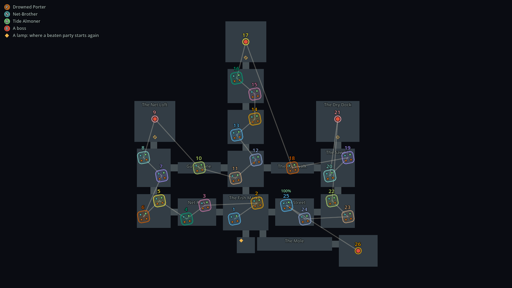

# Proposal: the big dungeon

Status: **a proposal for the owner to approve, written on 15 November 2026. Nothing here is built.** It is the first step of milestone 11 in [`routing-and-gear-plan.md`](routing-and-gear-plan.md), which says the owner approves the name, the layout, the new enemies, the bosses and the default route before any of it is made.

## 1. Name and place

**Tollhaven**: the harbour town under the Abbey, the one the great bell was rung for. It drowned on the same night. The tide draws back from it for twenty-five minutes.

Other names considered: Brinehaven, The Sunken Quay.

## 2. Layout

The sketch is drawn by the route map from a rough description of the rooms. Packs stand in for themselves only by position: what each is made of comes later. The numbers are the order of the proposed safe way.

- **The Sea Stair**, at the bottom: where the party starts, with the first lamp.
- **The Fish Market**: the hub. Three ways lead out of it, and a fourth is shut.
- **West wing**: Net Row, the Drying Yard, the Smokehouse, and the Net Loft, where the first boss is.
- **North wing**: Chandlers' Cross, the Counting Rooms, the Bonded Store, and the Custom House, where the second boss is.
- **East wing**: Keel Street, the Timber Yard, the Sawpit, and the Dry Dock, where the third boss is.
- **Two cross passages**: Gutter Lane joins the Smokehouse to Chandlers' Cross, and the Ropewalk joins Chandlers' Cross to the Sawpit. With them the wings can be taken in any order, entered from either end, or left half done.
- **The Mole**: a long pier from the Fish Market to **the Harbour Light**, where the last boss is. Its gate opens when the other three bosses are dead.

Numbers:

- 22 packs of keepers: two in each of the ten wing and market rooms, one in each cross passage.
- 4 bosses, each with a lamp by the way out of its room.
- 3 patrols: one round the Fish Market, one along the Ropewalk, one round the Timber Yard.
- Rooms are 30 m or more across, so the pack in the far corner of a room can be walked past. The cross passages are 10 m wide: nothing in them can be walked past.
- The timer is 25:00.

## 3. Count

- The dungeon holds about 130% of the count it asks for. With packs worth 12 to 18, that leaves five or six packs standing, and which ones is the route's choice.
- The exact figures are set when the packs are made, and tuned in play.

## 4. New enemies

Four kinds, with the six the Abbey has. Each gives the route something to think about.

| Enemy | What it does | What it asks of the route |
|---|---|---|
| **Deckhand** | Weak, and six to a pack. Worth 1 count each. | Area damage is worth using, and so is pulling two packs of them together. |
| **Tide Crier** | Cry the Hour: a 3 s cast that wakes the nearest sleeping pack within 35 m. It can be silenced. | What is near a pull matters. Kill it first, or pull the neighbours on purpose. |
| **Shipwright's Mate** | Tarred Shield: it takes 60% less damage from the front. | The tank turns it away; where the tank holds the pull decides who can reach its back. |
| **Dredger** | Grapple: hooks the hero farthest from it and drags them to its feet. | Spots far from the fight are not safe from it. |

## 5. Bosses

| Boss | Where | The fight |
|---|---|---|
| **Mother Hask, the Netwife** | The Net Loft | She nets a hero, who cannot act until the net is cut down (the net is a target with health). Haul drags everyone netted to her feet and strikes round her. From level 6 she nets two at once. A check on switching targets. |
| **Exciseman Corrow** | The Custom House | The Audit: three casts one after another, each to be silenced, so the party must take turns. Each that lands puts a cleansable tax on a hero. Seize marks a hero with a wide circle to carry away from the party. From level 6 the Audit is four casts. A check on silences. |
| **Old Garrow, the Shipwright** | The Dry Dock | Launch: a hull runs down the slip through the middle of the dock, a long lane across the room with 3 s of warning. Pitch pots leave burning patches that stay, so the tank must keep moving him. From level 6 two hulls cross. A check on where everyone stands. |
| **The Keeper of the Light** | The Harbour Light | The Beam: a cone of light that turns slowly round the room and burns whoever is in it; walk ahead of it or stand behind a pillar. Lights Out at 60% and 30%: the room goes dark and each hero must reach a lit circle. Undertow hurts everyone, as Dirge does. From level 6 the beam turns faster. The last check: moving, healing and hiding together. |

## 6. The safe way

The route the party follows if nobody plans one, one pack to a pull:

1. The Fish Market.
2. West: Net Row, the Drying Yard, the Smokehouse, Mother Hask.
3. Gutter Lane to Chandlers' Cross, north through the Counting Rooms and the Bonded Store, Exciseman Corrow.
4. Back to the Ropewalk, the Sawpit, Old Garrow.
5. Down through the Timber Yard and Keel Street to the Fish Market.
6. The Mole and the Keeper of the Light.

It kills everything it walks past, so it takes all 22 packs: slow, with nothing clever in it, and it should still be inside the time at level 1. The time to be won is in what a planned route leaves out and what it pulls together.

## 7. What the game needs for it

Besides the level, the enemies and the bosses:

- **A choice of dungeon** on the setup screen. Levels stay shared between the two dungeons until milestone 12 keeps them for each.
- **Gates**: a doorway that is shut until certain bosses are dead.
- **Patrols**: a pack that walks a set path, shown on the map.
- **A time limit for each dungeon**: 14:00 for the Abbey, 25:00 here.
- **The party walking round packs** that are not in the pull, and the map's warning when a pull cannot be reached without waking another pack.
- Voice lines for the new pulls, bosses and lamps, and stand-in figures for the new cast, as the Abbey has.
